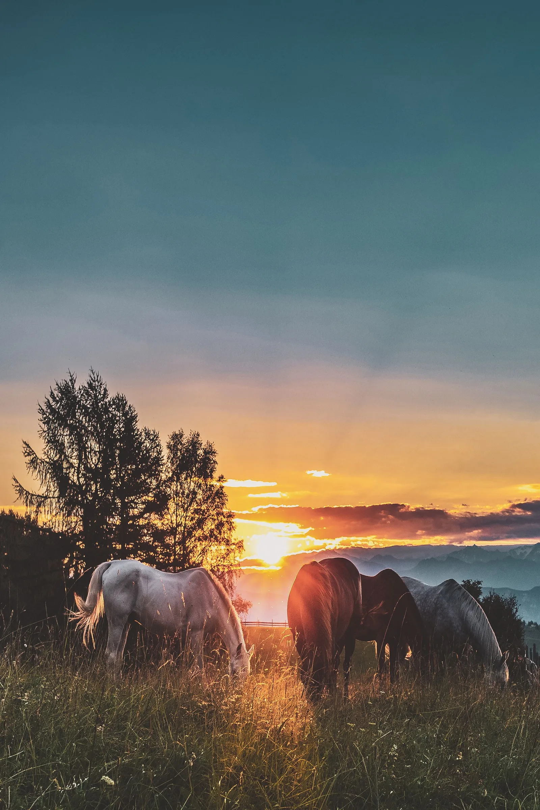

# Buying Horse Property in Florida: What to Look For in Pasture Acreage

Florida is one of the biggest horse states in the country. Ocala calls itself the Horse Capital of the World, and you'll find barns, trail riders, and backyard pastures in nearly every rural county. Mild winters let horses live outside most of the year, and grass grows for much of the year in much of the state.

But a parcel that's great for a house isn't always great for horses. Some land drains poorly, has too little open ground, or sits under zoning or deed restrictions that don't allow livestock at all. If you're searching for horse property for sale in Florida, here's what to look for before you buy.

## How Much Land Do You Need for Horses? Why 10 Acres Is the Sweet Spot

For most families who want to keep horses at home, **10 acres or more** is the size to look for. That's enough land for real pasture, a barn, a riding area, and a home, without any of them crowding each other.

Here's why 10 acres works so well:

- **Room for a home and the horses.** A homesite, driveway, barn, and hay storage can easily take up 2 to 3 acres. On a 10+ acre parcel, you still have plenty left for pasture.
- **Enough pasture to actually graze.** A common rule of thumb is about 2 acres of good pasture per horse if you want grass to provide a real share of the diet. With 6 to 8 acres in pasture, you can keep 2 to 4 horses on grass instead of relying mostly on hay.
- **Space to rotate paddocks.** Splitting pasture into two or more paddocks and rotating horses between them lets the grass recover. That's hard to do on a few acres and easy on 10 or more.
- **A riding area.** A round pen or arena takes space you won't have on a small lot.
- **Room for trees and privacy.** Leaving woods along the edges gives your horses shade, gives you a buffer from neighbors, and keeps the property feeling like a ranch.

Smaller parcels can work for one or two horses, but pasture quickly turns into a dry lot, and you end up buying more hay and fighting more mud. Keep in mind that North Florida grasses slow down in winter, so most owners feed extra hay from late fall through early spring no matter how much land they have. More acreage just means you depend on it less the rest of the year.

## What Makes Good Horse Pasture in Florida

### Well-drained ground

Drainage matters more than almost anything else. Horses standing in wet ground for long periods are more prone to hoof problems, and soggy paddocks quickly turn to mud and lose their grass. Look for land that's level to gently rolling, with no standing water a day or two after a heavy rain. If you can, walk the property after a storm.

Check the FEMA flood zone and look for wetlands on the parcel, too. Wetlands can't simply be cleared and fenced into pasture, and low areas are rarely where you want a barn.

### The right grass

Most Florida horse pastures are planted in warm-season perennial grasses such as **bahiagrass** or **bermudagrass**. Bahiagrass is very common because it tolerates sandy soils, drought, and heavy grazing. If a parcel is already in established pasture, you're starting well ahead of someone who needs to clear and plant.

Ask the seller what's growing there and how it has been used. Land that was recently in hay or cattle pasture is usually a good sign. A soil test, which you can request through your local UF/IFAS Extension office, will tell you what the ground needs in lime and fertilizer.

### Shade and shelter

Florida summers are hot and humid, and horses need relief from the sun. A mix of open pasture and trees is ideal. Mature trees along fence lines or in a corner of a paddock give natural shade, and you can add a run-in shed for storms and the hottest afternoons.

### A safe pasture

Walk the whole property and look for things that could hurt a horse: old wire fencing, junk or debris, holes, and plants that are toxic to horses. Red maple, black cherry, and some ornamental shrubs are worth knowing on sight. Your local extension office or a veterinarian can help you identify problem plants.

## Zoning, Deed Restrictions, and Rules to Confirm Before You Buy

This is where buyers get caught most often. Before you make an offer, confirm that horses are allowed, how many, and what you can build for them.

1. **Zoning and future land use.** Agricultural and rural residential zoning usually allows horses, but some residential zones don't, or they limit the number of animals per acre. Call the county planning and zoning office with the parcel ID.
2. **Deed restrictions and HOA rules.** Many subdivisions ban livestock or limit outbuildings, even in rural areas. Read the restrictions in full, not just the listing summary.
3. **Barn and building permits.** Ask what permits you'll need for a barn, run-in shed, or arena, and what setbacks apply from property lines and wells.
4. **Water.** Horses drink a lot, often 10 gallons a day or more in Florida heat. On rural land without city water, plan for a well and confirm well permitting with the water management district.
5. **Agricultural classification.** Florida's agricultural tax classification (often called "greenbelt") applies to land used for bona fide commercial agriculture. Keeping a few personal horses usually doesn't qualify on its own, but breeding, boarding, or hay production might. The county property appraiser makes the call, so ask them before you count on lower taxes.

Our guide to [10 things to consider before buying land in Florida](/blog/10-things-to-consider-before-buying-land-in-florida) goes deeper on zoning, wetlands, and permits.

## Setting Up the Property: What to Budget For

Raw land priced right can make a great horse property, but plan for the setup costs:

- **Fencing.** Board, wire mesh made for horses, or electric tape are common choices. Barbed wire is a poor choice for horses. Fencing is often one of the biggest costs on a new horse property.
- **A barn or run-in shed.** Even simple shelter adds up, so start with what you need and expand over time.
- **Water and power to the barn.** Running a water line and electricity out to the barn and paddocks is easier to plan before you build than after.
- **Driveway and gates.** Make sure a truck and horse trailer can get in, turn around, and get out, even in wet weather.
- **Pasture improvement.** Clearing, soil amendments, and seeding if the land isn't already in grass.
- **Hay storage.** A dry, ventilated spot to keep hay through the winter.

If you plan to finance the land and then build over time, see [How to Finance Land in Florida: 6 Ways to Fund Your Purchase](/blog/how-to-finance-land-in-florida-6-ways-to-fund-your-purchase).

## Location: What Horse Owners Should Look For Nearby

The land is only half of it. Before you buy, check what's around it:

- **An equine veterinarian** who makes farm calls in the area, and the nearest emergency equine hospital.
- **A farrier** who serves the county.
- **Feed and hay suppliers.** Rural counties with lots of cattle and hay operations usually have plenty of local hay.
- **Trails and riding.** State parks, forests, and trail systems you can trailer to.
- **Hurricane plans.** All of Florida has hurricane risk. Have a plan for where your horses will shelter, and keep their Coggins test and records current so you can move them quickly if you need to.

## Why North Florida Works Well for Horse Owners

Central Florida around Ocala gets most of the attention, and prices there reflect it. Buyers looking for more acreage for the money are increasingly looking at the Florida Panhandle, in counties like Jackson, Washington, and Holmes.

North Florida has rolling ground, a long tradition of cattle and hay farming, and rural zoning that's friendly to livestock. Winters are cooler than on the peninsula, so you'll feed a bit more hay, but you also get real seasons. Land in the Panhandle is commonly sold in 10+ acre tracts, which is the size most horse owners are looking for anyway.

Around Marianna in Jackson County, you also get easy access to Florida Caverns State Park, the Chipola River, and Blue Springs Recreation Area, with Panama City Beach about an hour away. We cover the area in [Things to Do Near Marianna, FL](/blog/things-to-do-near-marianna-fl-why-buyers-are-choosing-land-in-jackson-county).

## Frequently Asked Questions

### How many horses can I keep on 10 acres in Florida?

Most 10 acre parcels comfortably fit 2 to 4 horses once you set aside room for a home, barn, and some trees, with hay to supplement in winter. Parcels in the 10 to 17 acre range give you even more pasture to rotate. Check county zoning too, since some zones set a limit on animals per acre.

### What is the best grass for horse pasture in Florida?

Bahiagrass and bermudagrass are the most common choices. Bahiagrass handles sandy soil, drought, and grazing well. Bermudagrass is popular for hay and well-managed pastures. Your local UF/IFAS Extension office can recommend the best variety for your soil.

### Do horses qualify land for an agricultural exemption in Florida?

Not usually on their own. Florida's agricultural classification requires bona fide commercial agricultural use. Personal riding horses typically don't qualify, but a breeding, boarding, or hay operation might. The county property appraiser decides, so ask before you buy.

### Is wooded land or open pasture better for horses?

Open pasture is ready to use right away, while wooded land needs clearing and seeding before it can be grazed. Many horse owners prefer a parcel with both: open ground for pasture and riding, and trees for shade, privacy, and a windbreak.

## Horse-Friendly Acreage at Blue Springs Ranch

[Blue Springs Ranch](/blue-springs-ranch) is our community of 23 individually surveyed parcels, each roughly 10 to 17 acres, just outside Marianna in Jackson County. Some parcels are fully wooded. Others have wide-open pasture and level ground that's ideal for horses or a future ranch site, and many have both.

Every parcel comes with road frontage, professionally surveyed boundaries, completed title work, and a warranty deed. The property is about a mile from Blue Springs Recreation Area and less than 10 minutes from Marianna. Parcels start at $99,700, and financing assistance is available.

If you're looking for horse property in Florida, [see the available parcels at Blue Springs Ranch](/blue-springs-ranch) or [contact our team](/#contact). We'll help you find a parcel with the pasture, shade, and space your horses need.
